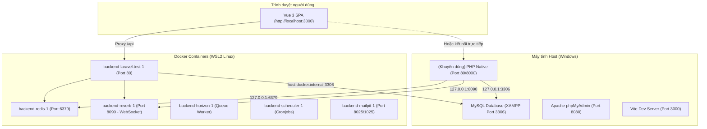

# ⚙️ Hướng dẫn AI Cấu hình Môi trường & Tối ưu Hiệu năng (AI Configuration & Performance Guide)

Tài liệu này cung cấp các nguyên tắc, kiến trúc và quy trình chuẩn giúp AI Agent và Lập trình viên cấu hình môi trường, duy trì hiệu năng cao nhất (thời gian tải dữ liệu API < 1s, đạt mốc 200–300ms) và đảm bảo an toàn tuyệt đối khi triển khai (deploy).

---

## 📌 1. Bức tranh Kiến trúc Hệ thống Local (Local Topology)

Dự án Equipment Manager hoạt động trên mô hình kết hợp (**Hybrid Development Architecture**):



---

## ⚠️ 2. Bản chất Vấn đề: Vì sao Local bị Chậm 4 - 5 giây?

Khi làm việc trên môi trường Windows + Docker, AI **bắt buộc phải ghi nhớ nguyên nhân cốt lõi** sau để không phán đoán sai:

1. **Nút thắt cổ chai File I/O (WSL2 9P / drvfs Mount):**
   - Mã nguồn nằm tại ổ cứng Windows NTFS (`C:\xampp\htdocs\equipment_manager\Backend`), được mount vào container Linux tại `/var/www/html`.
   - Mỗi request Laravel nạp 300 - 500 file PHP. Khi gọi qua tầng ảo hóa 9P giữa Windows và Linux, mỗi hàm `stat()`, `file_exists()`, `require` mất 1–3ms (so với 0.05ms trên Linux ext4 bản địa).
   - Trình duyệt SPA khi mở trang sẽ bắn 4–5 request đồng thời (`stats`, `map-view`, `room-options`, `broadcasting/auth`), các worker tranh chấp I/O đĩa NTFS khiến phản hồi bị dội lên **4–5 giây/request**.
2. **PHP CLI mặc định tắt OPcache:**
   - Lệnh `artisan serve` chạy trên PHP CLI. Nếu không có `opcache.enable_cli=1`, PHP dịch mã nguồn lại từ đầu trên mỗi request.
3. **Thiếu Autoload Classmap:**
   - Nếu chưa chạy `composer dump-autoload -o`, Composer phải dùng PSR-4 duyệt đĩa tìm hơn 9.600 class.
4. **Xdebug gây suy giảm hiệu năng:**
   - Dù `XDEBUG_MODE=off`, nếu module `xdebug.so` vẫn được nạp, PHP sẽ vô hiệu hóa JIT và gắn cờ hook vào từng hàm.

---

## 🚀 3. Hai Chế độ Chạy Local (Chọn 1 trong 2)

AI cần hướng dẫn lập trình viên lựa chọn chế độ phù hợp:

### 🏆 Chế độ 1: Siêu tốc Hybrid (Khuyên dùng - 200ms đến 300ms)
Chạy Laravel API trực tiếp bằng PHP Windows của XAMPP, dùng Docker cho Redis, Reverb, Horizon, Mailpit:

1. **Dừng container web Docker (để nhường cổng 80 hoặc dùng cổng 8000):**
   ```bash
   docker stop backend-laravel.test-1
   ```
2. **Chạy server Laravel trên Windows:**
   ```powershell
   cd Backend
   php artisan serve --port=80
   ```
3. **Ưu điểm:** PHP Windows đọc file trực tiếp từ ổ cứng NTFS với Windows Cache Manager, tốc độ phản hồi đạt **0.25s (250ms)**, nhanh gấp 20 lần Docker bind mount!

---

### 🐳 Chế độ 2: Docker Hoàn Toàn (Đã được cấu hình tối ưu)
Nếu muốn tiếp tục dùng Docker:

1. File cấu hình chuẩn nằm tại [Backend/docker/php/custom.ini](file:///c:/xampp/htdocs/equipment_manager/Backend/docker/php/custom.ini):
   ```ini
   [PHP]
   post_max_size = 100M
   upload_max_filesize = 100M
   variables_order = EGPCS
   memory_limit = 512M

   [opcache]
   opcache.enable = 1
   opcache.enable_cli = 1
   opcache.memory_consumption = 256
   opcache.interned_strings_buffer = 16
   opcache.max_accelerated_files = 20000
   opcache.validate_timestamps = 1
   opcache.revalidate_freq = 2
   opcache.save_comments = 1
   ```
2. Đã mount vào [Backend/compose.yaml](file:///c:/xampp/htdocs/equipment_manager/Backend/compose.yaml) và đặt `PHP_CLI_SERVER_WORKERS: 2` (không đặt 8 worker để tránh nghẽn I/O).
3. Luôn chạy tối ưu classmap:
   ```bash
   docker exec backend-laravel.test-1 composer dump-autoload -o
   ```
4. **Mẹo tối thượng nếu muốn Docker đạt 50ms:** Chuyển mã nguồn vào phân vùng Linux bản địa của WSL2 (`\\wsl$\Ubuntu\home\<user>\equipment_manager`).

---

## 📋 4. Quy tắc Viết Code Backend Duy trì Hiệu năng Cao

Khi tạo mới hoặc chỉnh sửa API Backend, AI **bắt buộc tuân thủ 5 nguyên tắc sau:**

### 1. Phân loại Endpoint cho Middleware `LogActivity`
- Không được để `LogActivity` thực hiện ghi DB (`INSERT INTO log_activities`) trên các API GET đọc dữ liệu thường xuyên hoặc polling định kỳ (Map view, Stats, Options, Dropdown).
- Luôn kiểm tra và khai báo route vào mảng `$excludedPaths` trong [LogActivity.php](file:///c:/xampp/htdocs/equipment_manager/Backend/app/Modules/Core/Middleware/LogActivity.php):
  ```php
  protected static array $excludedPaths = [
      '/up',
      'api/broadcasting/auth',
      'broadcasting/auth',
      'api/settings/public',
      'api/motel/rooms/room-types',
      'api/motel/rooms/stats',
      'api/equipments/stats',
      'api/equipments/map-view',
      'api/equipments/room-options',
  ];
  ```

### 2. Tối ưu Truy vấn Thống kê (Aggregation)
- **CẤM:** Chạy nhiều câu truy vấn đếm riêng lẻ như:
  ```php
  // ❌ XẤU: 5 câu query count riêng biệt
  $total = Room::count();
  $ready = Room::where('status', 'ready')->count();
  $occupied = Room::where('status', 'occupied')->count();
  ```
- **CHUẨN:** Gom thành 1 câu `GROUP BY`:
  ```php
  // ✅ TỐT: Đúng 1 câu query duy nhất
  $counts = Room::where('organization_id', $orgId)
      ->select('status', DB::raw('count(*) as count'))
      ->groupBy('status')
      ->pluck('count', 'status')
      ->all();
  ```

### 3. Tránh triệt để N+1 Queries
- Luôn dùng Eager Loading (`with()`) khi trả về danh sách có quan hệ:
  ```php
  Room::with(['roomType', 'sharedWifiRoom', 'equipments.model.category'])
  ```
- Dùng `withCount()` khi chỉ cần số lượng thiết bị của phòng, không load toàn bộ quan hệ nếu chỉ lấy count.

### 4. Chiến lược Cache & Invalidation rõ ràng
- Cache các dữ liệu ít biến động (Blocks, Floors, Room Options, Room Types) bằng `cache()->remember()`.
- Cache key phải luôn gắn với `organization_id` và version để tránh rò rỉ dữ liệu giữa các tổ chức:
  ```php
  $cacheKey = 'equipment_map_view_' . $orgId . '_v' . $version . '_' . md5(json_encode($params));
  ```
- Bắt buộc gọi `invalidateMapCache($orgId)` sau mỗi thao tác thêm/sửa/xóa phòng hoặc thiết bị.

---

## 🔒 5. An toàn Triển khai (Production Deployment Safety)

Mọi cấu hình tối ưu hiệu năng phải đảm bảo tính tương thích và an toàn tuyệt đối khi triển khai lên Server Production:

| Thành phần | Hành vi ở Local | Hành vi ở Production | Đánh giá an toàn |
| :--- | :--- | :--- | :--- |
| **Logic API `stats`** | Gom 1 query `GROUP BY` | Gom 1 query `GROUP BY` | ✅ 100% an toàn, giảm 80% tải CSDL |
| **LogActivity exclude** | Không ghi DB cho GET map/stats | Không ghi DB cho GET map/stats | ✅ 100% an toàn, tránh phình CSDL |
| **OPcache 256MB** | Cache bytecode đệm 2s | Cache bytecode liên tục trong RAM | ✅ Chuẩn hóa Production Best Practice |
| **Classmap Autoload** | `composer dump-autoload -o` | `composer install --no-dev -o` | ✅ Bắt buộc trong script CI/CD |

---

## 🚀 7. Chạy Song Song: Chế độ Docker vs Chế độ Không Docker (Dual-Mode Running)

Để linh hoạt tối đa khi phát triển, hệ thống được cấu hình để có thể chạy **hoàn toàn bằng Docker** hoặc **hoàn toàn Native trên Windows (không cần Docker)**:

### ⚠️ Bản chất các lỗi thường gặp khi chạy Native Windows (`php artisan serve`):
1. **Lỗi `Call to undefined function imagecreatefromstring()`**: Do PHP XAMPP chưa mở extension `gd`.
   - *Cách xử lý*: Mở `C:\xampp\php\php.ini`, bỏ dấu `;` ở các dòng `extension=gd`, `extension=exif`, `extension=sockets`.
2. **Lỗi `Pusher error: cURL error 6: Could not resolve host: reverb`**: Do file `.env` để `REVERB_HOST=reverb`.
   - *Cách xử lý*: Đặt trong `.env` là `REVERB_HOST=127.0.0.1`. Khi chạy Docker, file `compose.yaml` đã tự động ghi đè biến này thành `reverb` (`environment: REVERB_HOST: reverb`), nên cả 2 môi trường cùng dùng chung 1 file `.env` hoàn hảo!
   - Đồng thời, trong code Backend, mọi lệnh phát broadcast đều được bọc qua `safeBroadcast()` để nếu chưa bật Reverb thì request vẫn thực thi thành công, không làm sập giao diện người dùng.
3. **Lỗi chiếm cổng 80 (`Address already in use / Permission denied`)**:
   - Do container Docker vẫn đang bật (`docker ps`), hoặc Apache của XAMPP đang chạy, hoặc IIS của Windows.
   - *Cách xử lý*: Chạy `docker compose down` trước khi chạy `php artisan serve --port=80`, hoặc chạy trên cổng thay thế `php artisan serve --port=8000`.

4. **Lỗi đứt Storage Symlink giữa Windows và Docker**:
   - Khi chạy `php artisan storage:link` trên Windows, Windows tạo Junction chứa đường dẫn tuyệt đối `C:\xampp\...` $\rightarrow$ Docker Linux không hiểu ổ đĩa `C:\`.
   - Ngược lại khi tạo trong Docker, Linux tạo symlink `/var/www/html/...` $\rightarrow$ Windows không hiểu đường dẫn Linux.
   - *Giải pháp triệt để 2 lớp:*
     1. Dùng Symlink tương đối: `public/storage` $\rightarrow$ `../storage/app/public` (Cả Linux và Windows đều hiểu và trỏ đúng thư mục).
     2. Bổ sung Fallback Route `Route::get('/storage/{path}')` trong `routes/web.php` sử dụng `storage_path('app/public/' . $path)`. Dù symlink có bị lỗi thì ảnh vẫn được trả về chính xác 100% với HTTP 200 trên cả 2 môi trường.

### 📋 Hướng dẫn Khởi chạy:

#### Cách 1: Chạy bằng Docker (Khuyên dùng khi cần đầy đủ Redis & Reverb)
```bash
cd Backend
docker compose up -d
```
- Web backend chạy tại: `http://localhost` (port 80)
- WebSocket Reverb: `port 8090`
- Redis: `port 6379`
- Frontend: `npm run dev --prefix Frontend` (truy cập `http://localhost:3000`)

#### Cách 2: Chạy Native Windows không cần Docker (Tốc độ phản hồi cực nhanh, nhẹ máy)
```bash
# 1. Tắt Docker nếu đang chạy để giải phóng port 80
cd Backend
docker compose down

# 2. Khởi động MySQL trên XAMPP Control Panel (Port 3306)

# 3. Chạy Backend Laravel Native
php artisan serve --port=80
# (Hoặc nếu port 80 bị Apache XAMPP chiếm, có thể dùng --port=8000)

# 4. Khởi động Frontend
cd ../Frontend
npm run dev
```

---

## 🛠️ 8. Checklist Tự kiểm tra Dành cho AI (Self-Verification Checklist)

Trước khi hoàn tất bất kỳ tác vụ nào liên quan đến backend và cấu hình, AI phải kiểm tra:

- [ ] File `.env` không bị stage hay commit lên Git.
- [ ] Extension `gd`, `exif`, `sockets` đã được bật trong PHP local.
- [ ] Broadcast events được phát qua `safeBroadcast()` để an toàn khi Reverb không chạy.
- [ ] Không có query N+1 trong Controller hoặc Resource mới tạo.
- [ ] API tra cứu dữ liệu mới đã được thêm vào danh sách loại trừ của `LogActivity` nếu tần suất gọi cao.
- [ ] Các câu lệnh đếm trạng thái đã được gom nhóm bằng `GROUP BY`.
- [ ] Đã chạy linter syntax `php -l <file>` và unit test liên quan.
- [ ] Đã thực hiện `git add`, `git commit` chuẩn Conventional Commits và `git push origin main`.
