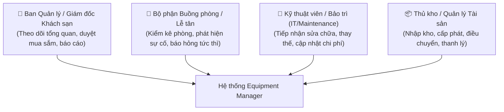
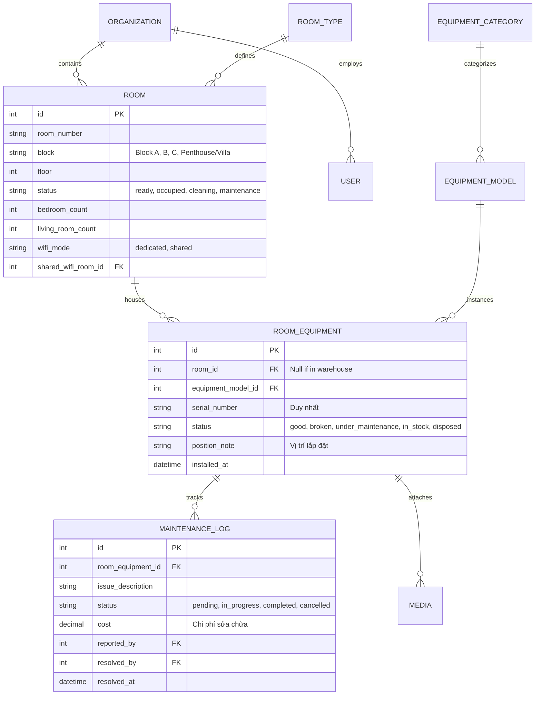
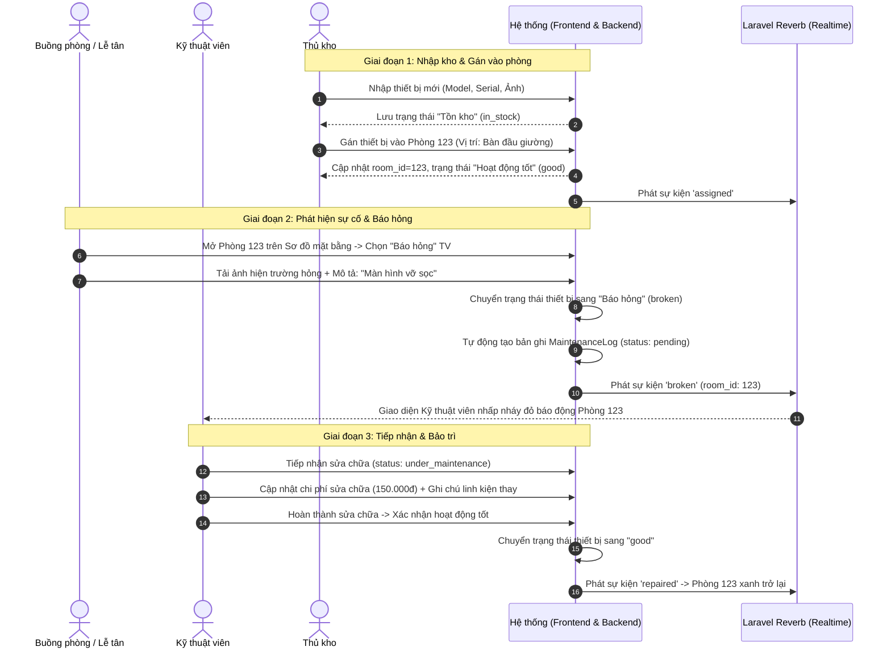
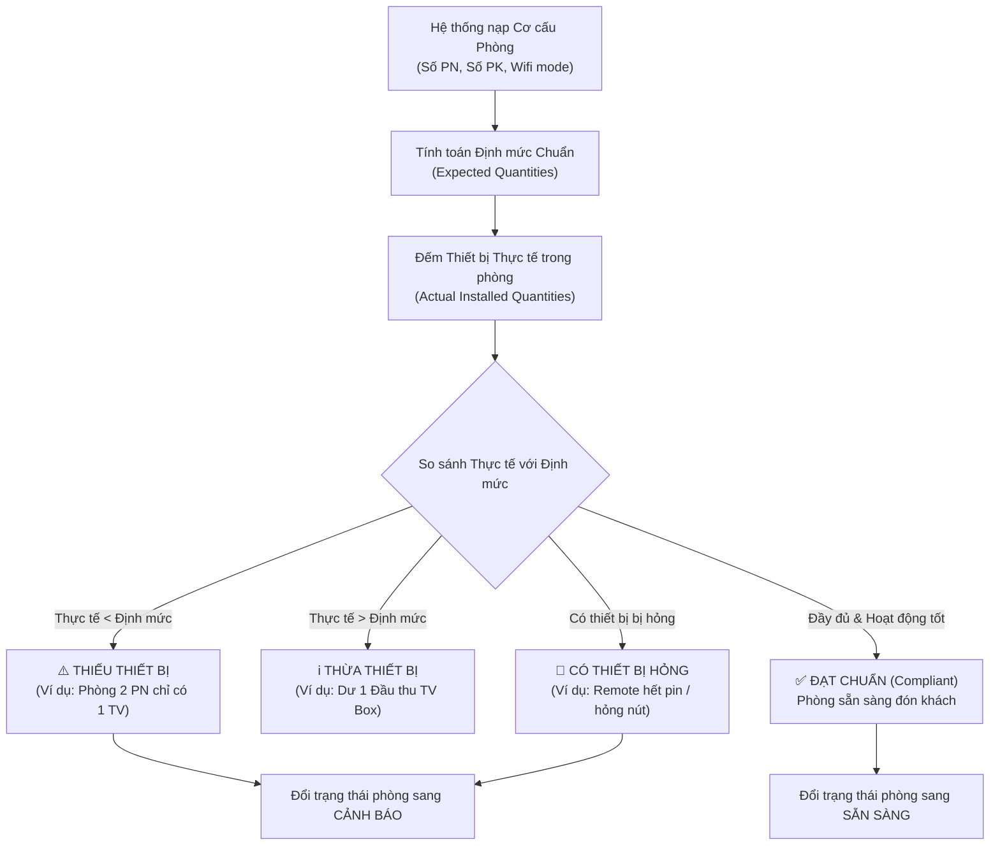
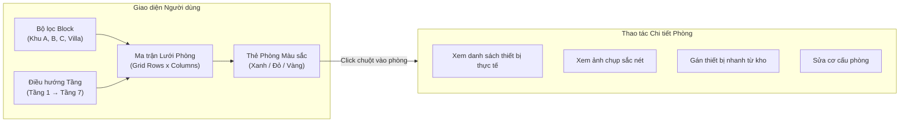
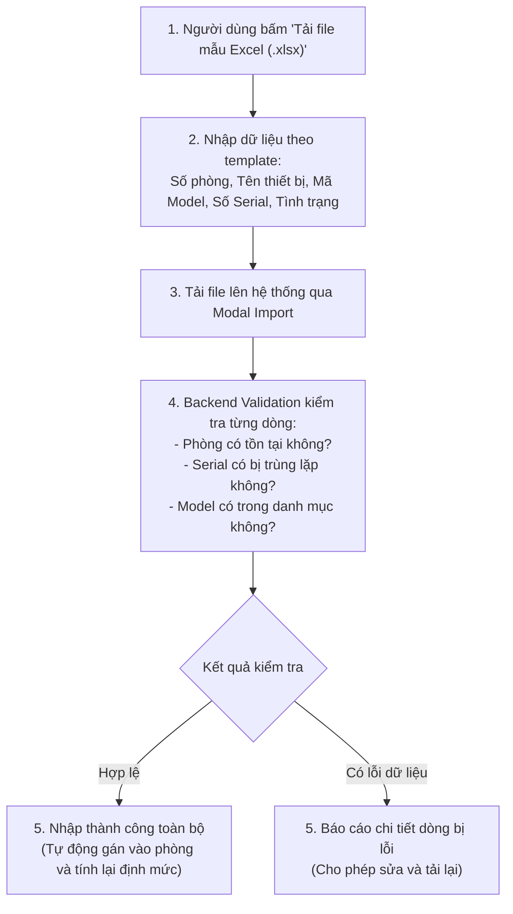
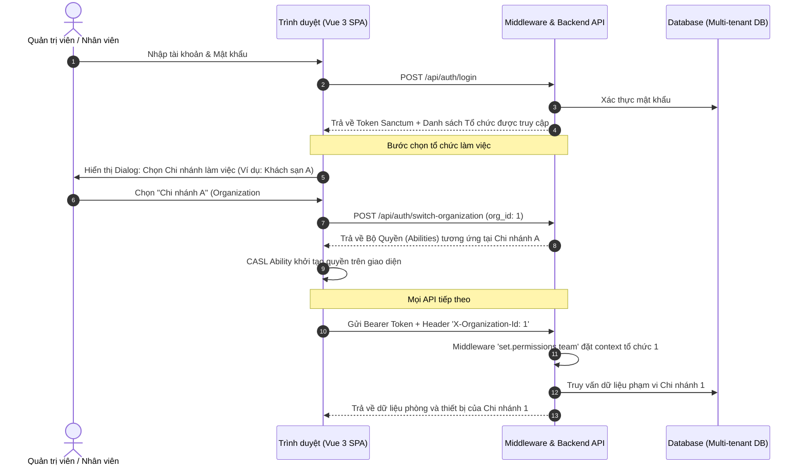

# 📖 TÀI LIỆU ĐẶC TẢ LUỒNG NGHIỆP VỤ HỆ THỐNG (BUSINESS WORKFLOW GUIDE)
## HỆ THỐNG QUẢN LÝ TRANG THIẾT BỊ KHÁCH SẠN (HOTEL EQUIPMENT MANAGER)

> **Mục tiêu tài liệu:** Cung cấp bức tranh toàn diện, chi tiết và chuẩn mực về các quy trình nghiệp vụ (Business Processes), vai trò người dùng (Actors), vòng đời tài sản (Asset Lifecycle) và luồng xử lý dữ liệu trong hệ thống Quản lý Trang thiết bị Khách sạn.

---

## 📑 MỤC LỤC
1. [Tổng quan Hệ thống & Các Đối tượng Sử dụng (Actors)](#1-tổng-quan-hệ-thống--các-đối-tượng-sử-dụng-actors)
2. [Sơ đồ Thực thể Nghiệp vụ Cốt lõi (Domain Entity Relationship)](#2-sơ-đồ-thực-thể-nghiệp-vụ-cốt-lõi-domain-entity-relationship)
3. [Luồng Nghiệp vụ 1: Vòng đời Quản lý Thiết bị (Equipment Lifecycle)](#3-luồng-nghiệp-vụ-1-vòng-đời-quản-lý-thiết-bị-equipment-lifecycle)
4. [Luồng Nghiệp vụ 2: Quản lý Buồng phòng & Định mức Động (Room Norms & Compliance)](#4-luồng-nghiệp-vụ-2-quản-lý-buồng-phòng--định-mức-động-room-norms--compliance)
5. [Luồng Nghiệp vụ 3: Giám sát Trực quan Thời gian thực (Live Realtime Floor Map)](#5-luồng-nghiệp-vụ-3-giám-sát-trực-quan-thời-gian-thực-live-realtime-floor-map)
6. [Luồng Nghiệp vụ 4: Nhập/Xuất & Đối soát Dữ liệu Hàng loạt (Excel Transfer)](#6-luồng-nghiệp-vụ-4-nhậpxuất--đối-soát-dữ-liệu-hàng-loạt-excel-transfer)
7. [Luồng Nghiệp vụ 5: Quản trị Tài khoản & Phân quyền Đa Chi nhánh (Multi-tenant RBAC)](#7-luồng-nghiệp-vụ-5-quản-trị-tài-khoản--phân-quyền-đa-chi-nhánh-multi-tenant-rbac)
8. [Ma trận Chuyển đổi Trạng thái Thiết bị (State Transition Matrix)](#8-ma-trận-chuyển-đổi-trạng-thái-thiết-bị-state-transition-matrix)

---

## 1. TỔNG QUAN HỆ THỐNG & CÁC ĐỐI TƯỢNG SỬ DỤNG (ACTORS)

Hệ thống phục vụ công tác quản lý tài sản, buồng phòng và vận hành bảo trì trong chuỗi khách sạn/khu nghỉ dưỡng với các đối tượng chính:

| Vai trò (Role) | Trách nhiệm chính | Màn hình thường trực |
| :--- | :--- | :--- |
| **Ban Quản lý (Admin / Super Admin)** | Xem chỉ số sức khỏe tài sản, giám sát tỷ lệ sẵn sàng phòng, định mức buồng phòng, phân quyền người dùng. | Bảng điều khiển (Dashboard), Phân quyền, Thống kê. |
| **Bộ phận Buồng phòng (Housekeeping)** | Kiểm tra phòng khi khách check-in/out, phát hiện thiết bị hỏng/thiếu, chụp ảnh bằng chứng và báo hỏng. | Sơ đồ mặt bằng (Map View), Định mức phòng, Chi tiết phòng. |
| **Kỹ thuật viên (Technician / IT)** | Nhận thông báo sự cố realtime, tiếp nhận sửa chữa, ghi nhận chi phí/linh kiện, bàn giao lại phòng. | Sơ đồ mặt bằng, Danh sách thiết bị, Lịch sử bảo trì. |
| **Thủ kho (Asset Manager)** | Quản lý trang thiết bị trong kho dự phòng, cấp phát thiết bị mới cho các phòng bị thiếu, xuất/nhập Excel. | Danh sách thiết bị, Nhập/Xuất Excel, Danh mục Model. |

---

## 2. SƠ ĐỒ THỰC THỂ NGHIỆP VỤ CỐT LÕI (DOMAIN ENTITY RELATIONSHIP)

---

## 3. LUỒNG NGHIỆP VỤ 1: VÒNG ĐỜI QUẢN LÝ THIẾT BỊ (EQUIPMENT LIFECYCLE)

Vòng đời thiết bị trải qua 5 giai đoạn: **Nhập kho $\rightarrow$ Cấp phát vào phòng $\rightarrow$ Vận hành & Báo hỏng $\rightarrow$ Bảo trì sửa chữa $\rightarrow$ Thu hồi / Thanh lý**.

---

## 4. LUỒNG NGHIỆP VỤ 2: QUẢN LÝ BUỒNG PHÒNG & ĐỊNH MỨC ĐỘNG (ROOM NORMS & COMPLIANCE)

Hệ thống giải quyết bài toán kiểm kê buồng phòng phức tạp bằng cơ chế **Định mức Động theo Cơ cấu Phòng**:

### 📐 Quy tắc Tính toán Định mức Tự động:
1. **Thiết bị Hiển thị & Giải trí:**
   $$\text{Định mức TV} = \text{Số phòng ngủ} + \text{Số phòng khách}$$
   $$\text{Định mức Điều khiển TV} = \text{Số lượng TV thực tế}$$
   $$\text{Định mức TV Box} = \text{Số lượng TV thực tế}$$
2. **Thiết bị Mạng & Viễn thông:**
   $$\text{Định mức Wifi Router} = \begin{cases} 0 & \text{nếu phòng chọn chế độ Dùng chung Wifi (Shared)} \\ 1 & \text{nếu phòng có Router riêng (Dedicated)} \end{cases}$$
   $$\text{Định mức Điện thoại bàn} = 1 \text{ máy / phòng (liên lạc nội bộ buồng phòng)}$$

### 🔄 Quy trình Đối soát & Phát hiện Sai lệch:

---

## 5. LUỒNG NGHIỆP VỤ 3: GIÁM SÁT TRỰC QUAN THỜI GIAN THỰC (LIVE REALTIME FLOOR MAP)

Sơ đồ mặt bằng tương tác giúp nhân viên Lễ tân và Quản lý theo dõi tình trạng toàn bộ khách sạn trong một màn hình duy nhất:

- **Mã màu trạng thái phòng:**
  - 🟢 **Xanh lá (Ready/Good):** Tất cả thiết bị đầy đủ theo định mức và hoạt động hoàn hảo.
  - 🔴 **Đỏ (Has Broken Issues):** Có ít nhất một thiết bị đang bị báo hỏng cần xử lý gấp.
  - 🟡 **Vàng (Warning / Missing):** Thiếu thiết bị theo định mức hoặc đang chờ cấp bù từ kho.
  - ⚪ **Xám (In Maintenance / Cleaning):** Phòng đang dọn dẹp hoặc sửa chữa tổng thể.

---

## 6. LUỒNG NGHIỆP VỤ 4: NHẬP/XUẤT & ĐỐI SOÁT DỮ LIỆU HÀNG LOẠT (EXCEL TRANSFER)

Quy trình nhập liệu hàng loạt và kiểm kê tài sản định kỳ:

---

## 7. LUỒNG NGHIỆP VỤ 5: QUẢN TRỊ TÀI KHOẢN & PHÂN QUYỀN ĐA CHI NHÁNH (MULTI-TENANT RBAC)

Đảm bảo an toàn bảo mật khi một tập đoàn quản lý nhiều chi nhánh khách sạn:

---

## 8. MA TRẬN CHUYỂN ĐỔI TRẠNG THÁI THIẾT BỊ (STATE TRANSITION MATRIX)

Bảng quy định các trạng thái hợp lệ khi luân chuyển thiết bị:

| Trạng thái Hiện tại | Trạng thái Tiếp theo Hợp lệ | Thao tác kích hoạt | Ai có quyền thực hiện? |
| :--- | :--- | :--- | :--- |
| **Tồn kho (in_stock)** | Hoạt động tốt (`good`) | Gán thiết bị vào phòng cụ thể. | Quản lý kho, Quản trị viên |
| **Tồn kho (in_stock)** | Thanh lý (`disposed`) | Bỏ thiết bị ra khỏi danh sách tài sản. | Ban Quản lý |
| **Hoạt động tốt (good)** | Báo hỏng (`broken`) | Phát hiện hỏng hóc, gửi ảnh sự cố. | Buồng phòng, Kỹ thuật viên, Lễ tân |
| **Hoạt động tốt (good)** | Tồn kho (`in_stock`) | Tháo dỡ thiết bị khỏi phòng đem về kho. | Kỹ thuật viên, Quản lý kho |
| **Báo hỏng (broken)** | Đang sửa chữa (`under_maintenance`) | Kỹ thuật viên tiếp nhận xử lý phiếu. | Kỹ thuật viên bảo trì |
| **Đang sửa chữa (under_maintenance)** | Hoạt động tốt (`good`) | Sửa xong, nghiệm thu đạt chuẩn. | Kỹ thuật viên bảo trì |
| **Đang sửa chữa (under_maintenance)** | Thanh lý (`disposed`) | Hư hỏng nặng không thể sửa, xuất hủy. | Ban Quản lý, Kỹ thuật viên trưởng |

---

## 📌 KẾT LUẬN
Tài liệu luồng nghiệp vụ trên là kim chỉ nam cho các thành viên trong đội ngũ phát triển, kiểm thử (QA), và người dùng cuối. Bất kỳ tính năng mới nào được bổ sung đều phải tuân thủ và tích hợp đồng bộ vào các luồng nghiệp vụ đã được chuẩn hóa này.
