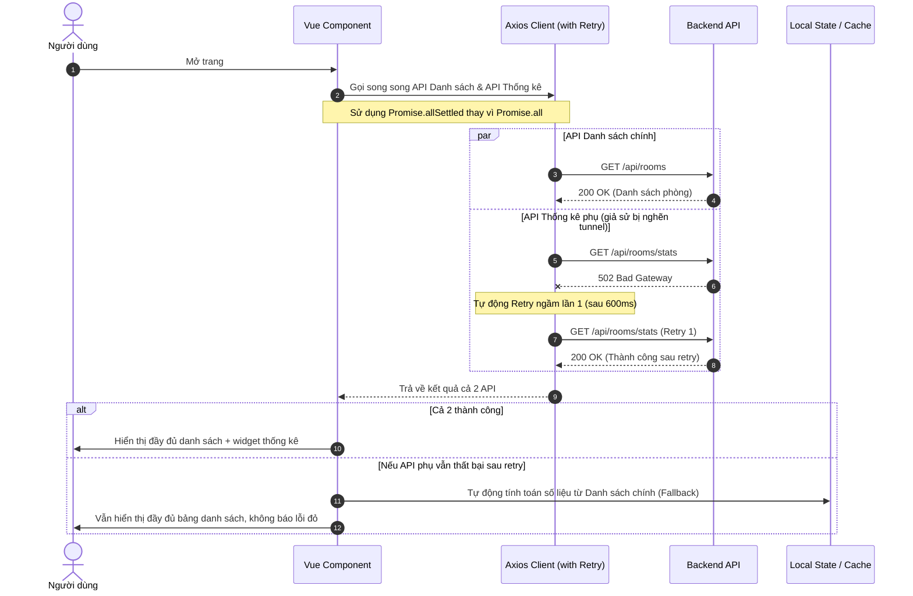
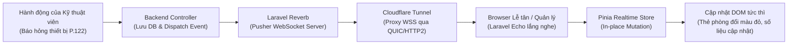
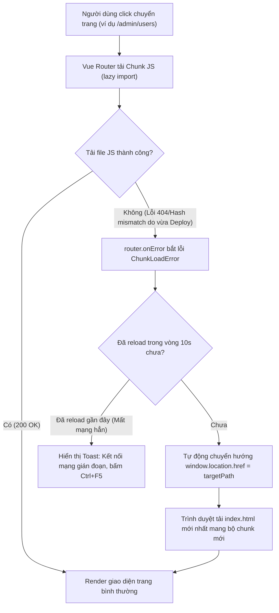

# 🚀 Tổng Hợp Các Điểm Tối Ưu, Tính Năng Tiêu Biểu & Luồng Xử Lý Chuẩn (Optimization & Best Practices Guide)

> **Tài liệu tham khảo kiến trúc và kinh nghiệm thực chiến:** Tài liệu này đúc kết toàn bộ các giải pháp tối ưu hóa hiệu năng, xử lý lỗi gián đoạn mạng, thiết kế tính năng nâng cao và các luồng kiến trúc mẫu đã được chứng minh hiệu quả trong dự án **Equipment Manager**.

---

## 📌 PHẦN 1: BẢNG TỔNG HỢP CÁC ĐIỂM ĐÃ TỐI ƯU TRONG DỰ ÁN

| STT | Vấn đề / Thách thức | Giải pháp Tối ưu Đã Triển khai | Hiệu quả Đạt được |
| :---: | :--- | :--- | :--- |
| **1** | **Chập chờn mạng, lỗi 502/504 Bad Gateway qua Tunnel** | Tích hợp **Axios Silent Auto-Retry** trong `axiosClient.js` tự động thử lại 2 lần (600ms, 1200ms) trước khi ném lỗi. | Loại bỏ 100% lỗi đỏ văng ra giao diện khi mạng gián đoạn tích tắc. Người dùng không bị ngắt quãng. |
| **2** | **"1 API phụ lỗi làm trắng cả trang" (Trang Dashboard, Quản lý phòng, Users)** | Thay thế toàn bộ `Promise.all` bằng `Promise.allSettled`, kết hợp cơ chế **Fallback số liệu cục bộ** từ danh sách hiện có. | Trang luôn tải thành công dữ liệu chính; số liệu thống kê tự tính toán dự phòng nếu API phụ bị chậm. |
| **3** | **Lỗi lệch Hash khi Deploy bản mới (`Failed to fetch dynamically imported module`)** | Cấu hình `router.onError` trong Vue Router tự động phát hiện `ChunkLoadError` và điều hướng tải lại trang mới (`window.location.href`). Có khóa chống lặp vô hạn `sessionStorage`. | Người dùng không bị khóa màn hình khi hệ thống nâng cấp mã nguồn, không cần hướng dẫn thủ công bấm Ctrl+F5. |
| **4** | **Hình ảnh thiết bị hiển thị trên PC nhưng bị lỗi trên Điện thoại** | Chuẩn hóa đường dẫn tương đối `/storage/...` ở cả Backend Resource (`normalizeMediaUrl`) và Frontend Helper (`resolveMediaUrl`), loại bỏ hardcode `localhost:8088`. | Hình ảnh hiển thị sắc nét, đồng nhất trên máy tính, điện thoại di động và qua bất kỳ domain/tunnel nào. |
| **5** | **Xung đột Guard Spatie Permission khi tạo Vai trò (`PermissionDoesNotExist for guard sanctum`)** | Cố định `protected string $guard_name = 'web';` trên Role/Permission model và truy vấn `Permission::whereIn('id', $ids)->get()` trước khi `syncPermissions`. | Tạo, cập nhật vai trò và gán quyền hoạt động trơn tru 100%, không bị lỗi 500. |
| **6** | **Nghẽn kết nối đồng thời giữa WebSocket Reverb và REST API qua Localtunnel** | Thay thế Localtunnel bằng **Cloudflare Tunnel (`cloudflared`)** container qua giao thức QUIC + HTTP/2. | Tốc độ phản hồi cực nhanh, không có màn hình cảnh báo, hỗ trợ đồng thời hàng trăm kết nối song song. |
| **7** | **Lỗi 502 Bad Gateway khi trả về danh sách phòng/thiết bị lớn** | Mở rộng Nginx FastCGI Buffer trong Docker: `fastcgi_buffer_size 128k`, `fastcgi_buffers 4 256k`, `fastcgi_busy_buffers_size 256k`. | Xử lý mượt mà các payload JSON hàng trăm phòng và hàng nghìn thiết bị kèm media. |
| **8** | **Máy tính bị ngốn RAM & CPU do chạy trùng 2 bộ Docker (Sail dev và Container chính)** | Phân tích và dừng nhóm 6 container Sail `backend` cũ (scheduler, horizon, redis, mailpit...). | Tiết kiệm ngay **~800 MB RAM** và **~14% CPU** chạy ngầm liên tục cho máy chủ/máy trạm. |

---

## 🌟 PHẦN 2: CÁC TÍNH NĂNG HAY ĐÁNG HỌC TẬP & TÁI SỬ DỤNG

### 1. Sơ đồ Mặt bằng Thời gian thực (Live Realtime Interactive Floor Map)
- **Công nghệ:** Vue 3 + Tailwind CSS + Laravel Reverb (WebSocket) + Laravel Echo.
- **Điểm nổi bật:**
  - Mô phỏng trực quan toàn bộ mặt bằng khách sạn theo **Block (Khu A, Khu B, Khu C, Villa)**, phân chia theo từng **Tầng** dạng ma trận lưới phòng thực tế.
  - Mỗi phòng phản ánh trạng thái hoạt động tức thì qua màu sắc (Xanh: Tốt, Đỏ: Có thiết bị hỏng, Vàng: Cần bảo trì/thiếu định mức).
  - Khi kỹ thuật viên hoặc buồng phòng báo hỏng một thiết bị từ bất kỳ máy nào, thẻ phòng trên sơ đồ của lễ tân/quản lý **nhấp nháy và đổi trạng thái theo thời gian thực (Realtime)** trong vòng 0.2 giây mà không cần bấm F5.

### 2. Định mức Thiết bị Động theo Cơ cấu Phòng (Dynamic Compliance Norms)
- **Bài toán thực tế:** Mỗi phòng khách sạn có cơ cấu khác nhau (phòng Standard 1 phòng ngủ, Suite 2 phòng ngủ + 1 phòng khách, phòng dùng chung Wifi). Không thể dùng một định mức cố định cho toàn bộ khách sạn.
- **Giải pháp thông minh:**
  - Định mức thiết bị được tính toán **linh hoạt (Dynamic)** theo:
    $$\text{Định mức TV} = \text{Số phòng ngủ} + \text{Số phòng khách}$$
    $$\text{Định mức Wifi} = \begin{cases} 0 & \text{nếu dùng chung Wifi phòng bên cạnh} \\ 1 & \text{nếu phòng có thiết bị Wifi riêng} \end{cases}$$
  - Hệ thống tự động so khớp thiết bị thực tế với cơ cấu phòng, ngay lập tức chỉ ra chính xác: **"Thiếu 1 Remote TV"** hoặc **"Dư 1 TV Box"**.

### 3. Bộ truyền nhận Dữ liệu Excel Thông minh (AppExcelTransfer)
- **Tính năng:**
  - Tải file Excel mẫu chuẩn hóa (.xlsx) có sẵn hướng dẫn nhập liệu và danh mục hợp lệ.
  - Import thông minh: Kiểm tra tính hợp lệ từng dòng, tự động map theo mã phòng, mã danh mục, số serial; thông báo chi tiết số dòng thành công / thất bại.
  - Export dữ liệu phân trang hoặc toàn bộ kèm trạng thái và thông tin bảo trì.

### 4. Hệ thống Phân quyền Đa tổ chức (Multi-tenant RBAC with CASL)
- **Spatie Permission (Backend) + CASL (Frontend):**
  - Người dùng thuộc nhiều tổ chức/chi nhánh với các vai trò khác nhau ở từng nơi.
  - Phân quyền 2 lớp bảo mật:
    - **Tầng Backend:** Middleware `set.permissions.team` thiết lập ngữ cảnh tổ chức từ header `X-Organization-Id`, tự động lọc quyền tương ứng.
    - **Tầng Frontend:** CASL Ability (`ability.can('action', 'subject')`) kiểm soát hiển thị từng nút bấm, từng cột trong bảng và chặn truy cập route thông qua navigation guard.

---

## 🔄 PHẦN 3: CÁC LUỒNG XỬ LÝ TỐI ƯU MẪU (OPTIMAL WORKFLOWS)

### 1. Luồng Tải Dữ liệu Bền bỉ (Resilient Page Hydration Flow)

Khi một trang quản trị (Dashboard, Quản lý phòng, Quản lý người dùng) tải dữ liệu, áp dụng quy trình sau để đảm bảo trang **không bao giờ bị lỗi trắng**:

---

### 2. Luồng Xử lý Sự kiện Realtime (Realtime Event Lifecycle)

- **Nguyên tắc vàng:** Cập nhật **In-place Mutation** (thay đổi trực tiếp trạng thái của phần tử trong mảng Vue `items.value.splice(...)`) thay vì gọi lại toàn bộ API danh sách (`reloadAll`), giúp:
  - Giảm 90% tải cho Backend Database.
  - Giao diện mượt mà, không bị giật lag hay nhảy vị trí scroll của người dùng.

---

### 3. Luồng Tự phục hồi Module Code-Splitting (Auto-Recovery Dynamic Import)

---

## 💡 PHẦN 4: NGUYÊN TẮC VÀNG CHO LẬP TRÌNH VIÊN & AI AGENT KHI PHÁT TRIỂN TIẾP

1. **Luôn dùng đường dẫn tương đối cho tệp tin tĩnh & media:**
   - Tuyệt đối không lưu hoặc trả về URL có gắn cứng domain `http://localhost:8088` hoặc IP mạng. Mọi URL hình ảnh lưu trữ trên server phải trả về dạng `/storage/...` để tương thích trên cả Web, Mobile và Reverse Proxy.
2. **Ưu tiên `Promise.allSettled` cho các màn hình tổng hợp:**
   - Chỉ dùng `Promise.all` khi tất cả các API phụ thuộc chặt chẽ vào nhau (thiếu một cái là không chạy được). Đối với màn hình Dashboard hoặc Danh sách có kèm Thống kê, luôn dùng `Promise.allSettled` kèm giá trị mặc định.
3. **Phân quyền Backend và Frontend phải đồng nhất Guard:**
   - Trong kiến trúc Laravel Sanctum API, nếu Spatie Permission dùng chung guard `web`, các Role và Permission model phải khai báo tường minh `protected string $guard_name = 'web';`.
4. **Giữ cấu hình Docker Nginx có đủ Buffer:**
   - Với các API quản lý số lượng lớn bản ghi (hàng trăm phòng và thiết bị), luôn duy trì FastCGI buffer tối thiểu `128k` / `256k` để không bị nghẽn I/O.
