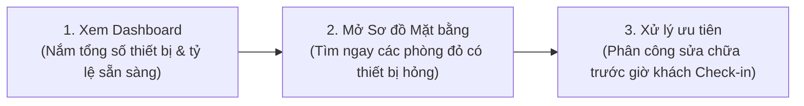
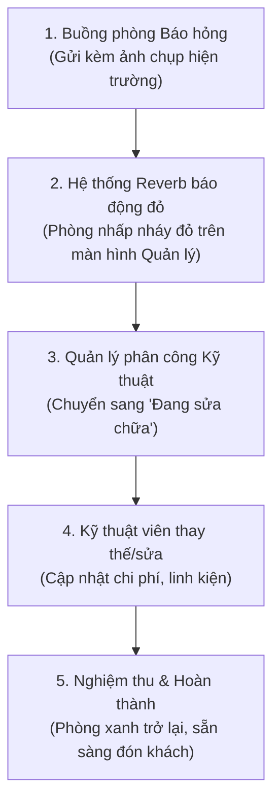

# 📘 CẨM NANG HƯỚNG DẪN NGHIỆP VỤ DÀNH CHO NGƯỜI QUẢN LÝ THIẾT BỊ
### (Dễ hiểu - Thực chiến - Dành cho Bộ phận Quản lý Tài sản & Kỹ thuật Khách sạn)

> **Mục tiêu:** Tài liệu này được viết bằng ngôn ngữ thực tế, dễ hiểu, hướng dẫn chi tiết từng bước (cầm tay chỉ việc) cho Người Quản lý Thiết bị, Thủ kho và Kỹ thuật viên khách sạn để vận hành trơn tru hệ thống mỗi ngày.

---

## 🧭 BẮT ĐẦU NGÀY MỚI: 3 BƯỚC NẮM TRỌN TÌNH HÌNH KHÁCH SẠN

Mỗi sáng khi bắt đầu ca làm việc, Người Quản lý mở hệ thống và thực hiện 3 thao tác nhanh:

1. **Xem Bảng điều khiển (Dashboard):**
   - Nhìn vào thẻ **"TỔNG SỐ THIẾT BỊ"** và **"ĐANG HOẠT ĐỘNG TỐT"** để xem tỷ lệ sẵn sàng buồng phòng (mục tiêu luôn $\ge 95\%$).
   - Nhìn vào ô màu hồng **"BÁO HỎNG / CẦN BẢO TRÌ"**: Đây là số lượng sự cố cần giải quyết ngay trong ngày.
2. **Kiểm tra Sơ đồ Mặt bằng (Map View):**
   - Bấm vào từng Block (**Block A, Block B, Block C, Villa**) để quét nhanh các phòng:
     - 🟢 **Phòng Xanh:** Đầy đủ đồ, hoạt động tốt $\rightarrow$ Yên tâm đón khách.
     - 🔴 **Phòng Đỏ:** Đang có thiết bị báo hỏng $\rightarrow$ Cần sửa gấp!
     - 🟡 **Phòng Vàng:** Bị thiếu thiết bị so với tiêu chuẩn phòng $\rightarrow$ Cần cấp bù từ kho!

---

## 🛠️ NGHIỆP VỤ 1: KHI KHÁCH SẠN NHẬP THIẾT BỊ MỚI VỀ KHO

Khi khách sạn mua thêm Tivi, Remote, TV Box, Đầu thu, Điện thoại bàn hay Router Wifi mới:

### 🔹 Cách 1: Thêm nhanh từng máy (Khi nhập số lượng ít: 1 - 5 máy)
1. Vào menu **Nghiệp vụ quản lý $\rightarrow$ Danh sách thiết bị**.
2. Bấm nút xanh **"+ Thêm thiết bị mới"** ở góc trên bên phải.
3. Điền các thông tin:
   - **Tên mẫu thiết bị (Model):** Chọn mẫu có sẵn (ví dụ: *TV Samsung 43 inch Smart FHD*). Nếu là loại mới hoàn toàn, bấm dấu cộng để tạo mẫu mới.
   - **Số Serial (Mã định danh):** Nhập số Serial dán sau lưng thiết bị (ví dụ: `SN-TV43-0992`). *Lưu ý: Mỗi máy có 1 số Serial duy nhất.*
   - **Vị trí gán:**
     - Nếu gán ngay vào phòng: Chọn số phòng (ví dụ: *Phòng 102*).
     - Nếu cất vào kho dự phòng: Chọn **"Lưu vào kho (Chưa gán phòng)"**.
   - **Ảnh chụp thiết bị:** Tải ảnh chụp mặt trước hoặc tem máy để sau này dễ đối soát.
4. Bấm **"Lưu thiết bị"** $\rightarrow$ Hoàn tất!

### 🔹 Cách 2: Nhập hàng loạt bằng file Excel (Khi nhập lô lớn: 20 - 500 máy)
1. Tại trang **Danh sách thiết bị**, bấm nút **"📥 Nhập/Xuất Excel"** $\rightarrow$ Chọn **"Tải file mẫu Excel"**.
2. Mở file Excel vừa tải về máy, nhập các cột:
   - `room_number`: Số phòng muốn gán (để trống nếu nhập về kho).
   - `model_code` hoặc `model_name`: Tên hoặc mã model (ví dụ: `TV-SS-43`).
   - `serial_number`: Số serial từng máy.
   - `position_note`: Vị trí đặt (ví dụ: *Treo tường*, *Táp đầu giường*).
3. Bấm **"Tải file lên"** trên hệ thống $\rightarrow$ Hệ thống tự kiểm tra và nạp toàn bộ máy vào kho trong 2 giây!

---

## 🏨 NGHIỆP VỤ 2: GÁN THIẾT BỊ TỪ KHO VÀO PHÒNG

Khi một phòng mới xây xong hoặc cần thay máy mới cho phòng:

### Thao tác trực tiếp từ Sơ đồ Mặt bằng (Rất nhanh & Trực quan):
1. Mở trang **Sơ đồ mặt bằng (Map)**.
2. Click chuột trực tiếp vào ô phòng cần lắp (ví dụ: click vào **Phòng 205**).
3. Hộp thoại thông tin phòng hiện ra, kéo xuống dưới bấm nút xanh: **"+ Gán thêm thiết bị"**.
4. Chọn danh mục cần lắp (Tivi / Remote / Wifi / Điện thoại bàn).
5. Hệ thống sẽ hiển thị danh sách các máy **đang có sẵn trong kho**. Bạn chỉ cần bấm **"Chọn máy này"** $\rightarrow$ Bấm **"Xác nhận gán"**.
6. Ngay lập tức thiết bị được đưa vào phòng, định mức phòng tự động cập nhật!

---

## 🚨 NGHIỆP VỤ 3: XỬ LÝ KHI CÓ THIẾT BỊ BÁO HỎNG

Khi buồng phòng dọn phòng phát hiện Tivi vỡ màn hình, Remote bị hỏng hoặc Điện thoại bàn không có tín hiệu:

### Các bước xử lý chi tiết:
1. **Tiếp nhận sự cố:**
   - Trên Sơ đồ mặt bằng, phòng có sự cố sẽ chuyển sang **Màu đỏ**.
   - Bấm vào phòng đỏ $\rightarrow$ Nhìn thấy ngay thiết bị nào bị hỏng, bấm vào xem **ảnh chụp bằng chứng hỏng hóc** và ghi chú của nhân viên buồng phòng.
2. **Tiến hành xử lý:**
   - Bấm nút **"Tiếp nhận bảo trì"** $\rightarrow$ Trạng thái chuyển sang *"Đang sửa chữa"*.
   - **Nếu cần thay thế ngay cho khách:** Bạn lấy 1 máy từ kho đệm gán tạm vào phòng. Máy hỏng thu hồi về phòng kỹ thuật.
3. **Hoàn tất & Lưu vết chi phí:**
   - Sau khi thợ sửa xong, bấm **"Hoàn thành sửa chữa"**.
   - Điền chi phí sửa chữa (nếu có thuê ngoài hoặc mua linh kiện, ví dụ: *Thay nguồn 200.000đ*).
   - Bấm **"Xác nhận"** $\rightarrow$ Thẻ phòng tự động chuyển về **Màu xanh an toàn**.

---

## 🔍 NGHIỆP VỤ 4: KIỂM SOÁT ĐỊNH MỨC (PHÒNG ĐỦ HAY THIẾU ĐỒ?)

Hệ thống có tính năng **Tự động tính định mức chuẩn theo cơ cấu phòng**:

### 📐 Quy chuẩn định mức khách sạn:
- **Tivi & Đầu thu & Remote:**
  - Phòng 1 phòng ngủ = Cần **1 Tivi + 1 Remote + 1 Box**.
  - Phòng Suite (2 phòng ngủ + 1 phòng khách) = Cần **3 Tivi + 3 Remote + 3 Box**.
- **Điện thoại bàn:** Mỗi phòng luôn cần **1 máy** để gọi lễ tân/cứu hộ.
- **Wifi Router:**
  - Nếu phòng dùng Router riêng $\rightarrow$ Cần **1 Router**.
  - Nếu phòng dùng chung Wifi với phòng bên cạnh (ví dụ: P.123 dùng ké Wifi của P.122) $\rightarrow$ Định mức Wifi là **0** (không bị báo thiếu).

### 💡 Cách phát hiện và xử lý phòng thiếu đồ:
1. Mở menu **Định mức thiết bị phòng**.
2. Hệ thống sẽ liệt kê danh sách phòng theo từng Block. Những phòng có chữ **"Thiếu thiết bị"** sẽ hiện thẻ màu cam/vàng.
3. Bấm vào phòng đó $\rightarrow$ Hệ thống chỉ đích danh: *"Thiếu 1 Remote Tivi"*.
4. Bạn chỉ cần bấm nút **"Cấp bù thiết bị"** $\rightarrow$ Chọn Remote từ kho để đưa vào phòng là xong.

---

## 🔄 NGHIỆP VỤ 5: ĐIỀU CHUYỂN, THU HỒI VỀ KHO & THANH LÝ

### 1. Chuyển thiết bị từ Phòng này sang Phòng khác:
- Vào **Danh sách thiết bị** $\rightarrow$ Tìm mã Serial của thiết bị.
- Bấm nút hình **Cây bút (Sửa)** $\rightarrow$ Tại mục "Phòng", chọn phòng mới $\rightarrow$ Bấm **Lưu**.

### 2. Thu hồi thiết bị về kho (Khi phòng sửa chữa / sơn lại):
- Mở chi tiết thiết bị $\rightarrow$ Bấm **"Tháo dỡ về kho"**.
- Máy sẽ chuyển trạng thái thành **"Tồn kho"** và không còn nằm trong phòng cũ nữa.

### 3. Thanh lý thiết bị (Hư hỏng quá nặng, cháy nổ, không thể sửa):
- Bấm vào thiết bị $\rightarrow$ Chọn trạng thái **"Thanh lý / Xuất hủy"**.
- Điền lý do thanh lý để lưu hồ sơ kế toán tài sản.

---

## 📊 NGHIỆP VỤ 6: XUẤT BÁO CÁO KIỂM KÊ CUỐI THÁNG

Mỗi kỳ kiểm kê tài sản hoặc báo cáo Ban Giám Đốc:
1. Vào **Danh sách thiết bị**.
2. Chọn bộ lọc:
   - Theo Block: Chọn **Block A**, **Block B**, **Block C** hoặc **Villa**.
   - Theo Tình trạng: Chọn **Đang hoạt động tốt**, **Báo hỏng** hoặc **Tồn kho**.
3. Bấm nút **"Xuất file Excel"** ở đầu bảng.
4. File Excel tải về đã được định dạng đẹp mắt, có sẵn ngày giờ xuất, người xuất và phân loại chi tiết theo từng phòng để in ra ký biên bản bàn giao.

---

## ❓ CÁC CÂU HỎI & TÌNH HUỐNG THƯỜNG GẶP (FAQ)

| Tình huống thực tế | Cách xử lý nhanh nhất |
| :--- | :--- |
| **Khách đổi phòng gấp vì Tivi hỏng, làm sao xử lý trên hệ thống?** | 1. Mở Sơ đồ mặt bằng $\rightarrow$ Bấm vào phòng cũ $\rightarrow$ Báo hỏng Tivi. 2. Bấm vào phòng mới khách chuyển sang $\rightarrow$ Kiểm tra thẻ phòng có màu xanh không. Nếu xanh là yên tâm phòng đã đủ đồ. |
| **Phòng 2 phòng ngủ nhưng khách sạn chỉ lắp 1 Tivi, hệ thống có báo thiếu không?** | Có, hệ thống sẽ báo thiếu 1 Tivi. Nếu thực tế cơ cấu phòng này chỉ quy định 1 Tivi, bạn bấm vào phòng $\rightarrow$ Bấm **"Sửa cơ cấu phòng"** $\rightarrow$ Chỉnh lại số Tivi chuẩn là hệ thống sẽ hết báo thiếu. |
| **Hai phòng cạnh nhau dùng chung 1 cục Wifi, cấu hình thế nào?** | Bấm vào phòng $\rightarrow$ "Sửa cơ cấu phòng" $\rightarrow$ Mục Wifi chọn **"Dùng chung Wifi"** $\rightarrow$ Chọn phòng đặt cục phát chính. Hệ thống sẽ ghi nhận và không báo thiếu Wifi cho phòng này. |
| **Xem trên điện thoại có thấy ảnh chụp thiết bị không?** | **Có đầy đủ 100%!** Bạn chỉ cần mở trình duyệt trên điện thoại truy cập đường link Cloudflare Tunnel là xem được ảnh sắc nét mọi lúc mọi nơi. |
